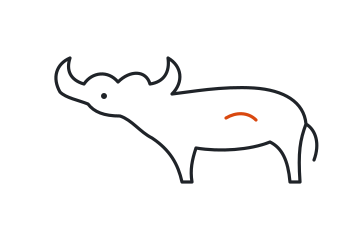

# Same inputs, same factory: why determinism matters in 2026

*The typeset paper is [WHITEPAPER.pdf](WHITEPAPER.pdf); this page is its text for reading on GitHub. Source, render script and the rebuild experiment: [docs/whitepapers/determinism-2026](docs/whitepapers/determinism-2026/).*

A factory that improves itself run against run is running an experiment, and an experiment only says something when everything except the treatment is held fixed. This paper reviews the evidence for reproducibility as a requirement in 2026, shows that functional package management delivers it at scale, reads the ouroboric-dev repositories for what they already pin and what they leave to chance, and proposes six concrete ways picasso's Nix labs can close the gap.

**Matheus Hoffmann** · Escola Politécnica, Universidade Federal do Rio de Janeiro · ORCID 0009-0009-1056-7661 · version 1.0, 12 October 2026

**Cite as:** Hoffmann, M. (2026). *Same inputs, same factory: why determinism matters in 2026* (Version 1.0). Zenodo. https://doi.org/10.5281/zenodo.XXXXXXXX  
Drafted with the assistance of Claude Code (Anthropic) and reviewed by the author.

### Abstract

**Background.** Three pressures converge in 2026. Computational results routinely fail to re-run: 74% of 9,000+ R files in published replication packages failed on first execution [17], and 4.03% of 1.4 million Jupyter notebooks reproduced their own results [18]. Supply-chain attacks target the gap between source and binary [8, 9, 10], and the EU Cyber Resilience Act's reporting obligations have applied since 11 September 2026 [12]. Coding agents add a stochastic generator to the build loop: at temperature 0, a production LLM endpoint gave 80 distinct completions out of 1,000 identical requests [24].

**Argument.** When the generator is stochastic, the rest of the system has to be deterministic, or no measured change can be attributed to its cause. Functional package management makes the environment a pure function of declared inputs. A 2025 study rebuilt 709,816 nixpkgs packages and found 69–91% bitwise reproducible and over 99% rebuildable [5].

**Case.** ouroboric-dev already pins its factory version, skills, config hash and agent CLI versions, and states that "benchmarks are only comparable with the same skills" [29]. Its specs say less about how the operating-system layer, the host tools and the container images are pinned. We show that 12 of the 14 tools its check ladder and sandbox name are packaged in picasso's pinned nixpkgs, and that an OCI image built from them rebuilds bit-for-bit (§5).

**Proposal.** Six additions, from a `labs/factory` lab to an environment hash in Yggdrasil's ledger, each mapped to a section of the Yggdrasil v0 spec, with an evaluation plan and the limits of what Nix can and cannot fix.

## 1. Introduction

Ouroboric (ouroboric.dev) builds "open factories that improve themselves", starting with Yggdrasil, a software factory, and Asgard, a company factory that runs on it [29]. Its charter makes measurement the core claim: "every claim about a factory rests on runs", and the first north-star measure is that "each factory measurably improves per iteration on its own benchmarks: hidden acceptance score, first-pass rate and cost per task, run against run."

That is a scientific claim, and it inherits the conditions of one. To say that run *B* is better than run *A* because of a change to a prompt, a graph or a model, one has to know that nothing else changed, or measure what did. A compiler that updated overnight, a base image whose `apt-get install` resolved differently, or a linter whose new release flags new findings, can move every metric the charter cares about without any change to the factory.

picasso (github.com/h0ffmann/picasso, formerly `nix-config`) is a set of self-contained Nix flakes, called labs, that other repositories borrow as a flake input, a sparse submodule or a GitHub Action. Its organising rule is stated in one line: "a toolchain is a dependency, so pin it like one" [30]. This paper asks what that rule is worth to ouroboric-dev, and answers with evidence from the literature, from the ouroboric-dev repositories and from two rebuild experiments.

Method. We read every Markdown file in ouroboric-dev/ouroboric (4ab80ed), yggdrasil (54ea51f), asgard (8bdbc03) and .github (b799793), all at their 12 October 2026 heads. References were found by literature search and each was checked against a primary record (Crossref, arXiv, the publisher or the official register) before being cited; numbers quoted are those in the checked record. No reference was written from memory.

## 2. Definitions

The terms are used loosely in practice, so we fix them here.

| term                    | meaning in this paper                                                                                                                                 | source                            |
|-------------------------|-------------------------------------------------------------------------------------------------------------------------------------------------------|-----------------------------------|
| reproducibility         | obtaining consistent results using the same input data, computational steps, methods, code and conditions of analysis                                 | NASEM [15]                   |
| replicability           | obtaining consistent results across studies aimed at the same question, each with its own data                                                        | NASEM [15]                   |
| reproducible build      | "given the same source code, build environment and build instructions, any party can recreate bit-by-bit identical copies of all specified artifacts" | reproducible-builds.org [28] |
| rebuildability          | a build that still succeeds from its recorded inputs, whether or not the output is bit-identical                                                      | Malka et al. [5]             |
| deterministic component | one whose output is a function of its declared inputs alone; here: the environment, the tools, the checks and the grader                              | this paper                        |
| stochastic component    | one whose output varies for fixed declared inputs; here: model inference behind an agent CLI                                                          | this paper, after [23, 24]   |

The distinction in the last two rows is the paper's central device. We do not claim agents can be made deterministic. We claim that everything around them can, and that this is what makes their variance measurable.

## 3. Why determinism, why 2026

### 3.1 Computational results do not re-run by default

The reproducibility deficit is measured, not anecdotal. In a *Nature* survey of 1,576 researchers, more than 70% had tried and failed to reproduce another scientist's experiments and more than half had failed to reproduce their own [13]. Where code is published, it often does not run: Trisovic et al. executed over 9,000 R files from 2,000+ Harvard Dataverse replication datasets in a clean environment and 74% failed to complete without error, 56% after automatic code cleaning [17]. Pimentel et al. re-ran 1.4 million Jupyter notebooks from GitHub; 24.11% executed without errors and 4.03% produced the same results [18]. In AI research, a survey of 400 IJCAI and AAAI papers found that none documented every variable needed to reproduce its results, and that 20–30% of the variables per factor were documented [19]. Collberg and Proebsting reached the same conclusion for computer-systems research by trying to build the artefacts of published papers themselves [16].

Peng's argument that computational science needs the code and data alongside the paper [14], and the FAIR principles' demand that research objects be reusable [21], are necessary but, these studies show, not sufficient: code without its environment decays. Hinsen calls this *software collapse*: software stops working because the layers beneath it change, not because it changed [20]. Containers were proposed as the remedy [22], and they freeze a result, but a Dockerfile that runs `apt-get update` describes a different image every day it is built.

### 3.2 The supply chain attacks the space between source and binary

Thompson showed in 1984 that a compromised compiler can insert a backdoor that appears in no source code [7]. Forty years later the attack surface is the whole dependency graph. Ohm et al. collected 174 malicious packages used in real attacks [8], and Ladisa et al.'s taxonomy of attacks on open-source supply chains lists 107 attack vectors [9]. The xz-utils backdoor (CVE-2024-3094) is the case study for this paper: the malicious code was in the *upstream tarballs* of xz 5.6.0 and later, and "the liblzma build process extracts a prebuilt object file from a disguised test file" [10]. A build that can be re-derived from audited inputs, by independent parties, to the same bits, is the defence the reproducible-builds community has argued for [6]: if two builders disagree, something in the chain is not what it claims. SLSA, the industry framework for build integrity, grades build platforms by provenance and isolation [11]; reproducibility is what lets a third party check that provenance.

### 3.3 Regulation now asks for it

The EU Cyber Resilience Act, Regulation (EU) 2024/2847, requires manufacturers of products with digital elements to identify and document the components of their products, "including by drawing up a software bill of materials" covering at least the top-level dependencies (Annex I, Part II) [12]. Its vulnerability and incident reporting obligations have applied since 11 September 2026; most other obligations apply from 11 December 2027 [12]. An SBOM is a claim about what is in an artefact. A build whose every input is a hashed store path makes that claim checkable rather than declarative. Ouroboric does not ship products into the EU market today, but the products its factories build may, and the charter says what operators build "is yours" [29]: the factory's output should come with evidence an operator can use.

### 3.4 Agents put a stochastic generator inside the loop

The new element in 2026 is the generator. Ouyang et al. sent the same 829 code-generation problems to ChatGPT repeatedly; the share of tasks with zero equal test outputs across requests was 75.76% on CodeContests, 51.00% on APPS and 47.56% on HumanEval, and temperature 0 reduced but did not remove the variation [23]. He (Thinking Machines Lab, 2025) traced the residual nondeterminism of inference servers to kernels that are not batch-invariant: server load changes the batch size, so one user's output depends on other users' traffic. At temperature 0, 1,000 identical requests to Qwen3-235B produced 80 unique completions; with batch-invariant kernels, all 1,000 were identical [24]. Benchmarks are fragile too. Yggdrasil scores its hidden suite "SWE-bench style" (spec §11), after Jimenez et al. [26], and Zhu et al. show that flaws in task setup or reward design can over- or under-estimate agent performance by up to 100% in relative terms [27].

Two consequences follow for a factory. First, **variance budgets**: if the model contributes irreducible variance, every other source of variance must be removed, or a measured improvement cannot be told apart from noise. Second, **attack surface**: prompt injection lets text in a repository steer an agent [25], so an agent's environment is part of its security boundary, and an environment that changes between runs is a boundary nobody reviewed.

> **The thesis.** In 2026 the question is no longer whether to make a build reproducible, but where to draw the line between what is held fixed and what is measured. A self-improving factory draws it around the model: the environment, the tools, the checks and the grader are deterministic and hashed; the model is the one stochastic input, and its variance is estimated by repetition, not assumed away.

## 4. The mechanism: functional package management

Nix, introduced by Dolstra and de Jonge in 2004 [1], treats a build as a pure function. Every package is stored under a path that is a cryptographic hash of all its inputs (sources, dependencies, build script, compiler flags), builds run in a sandbox without network access except for fixed-output fetches whose content hash is declared in advance, and two packages that differ in any input cannot collide. NixOS extended this to a whole operating system [2], and GNU Guix applied the same model to HPC [3]. Flakes add a lock file that pins every input to a revision and a content hash, which is what picasso's labs commit.

The model has now been tested at the scale of the largest software distribution. Malka, Zacchiroli and Zimmermann reconstructed the build environments of about 7 million Nix packages from historical data and rebuilt 99.94% of the 14,000 packages of a six-year-old nixpkgs revision [4]. Their follow-up rebuilt 709,816 packages from nixpkgs snapshots sampled between 2017 and 2023: 69–91% were bitwise reproducible, with an upward trend, rebuildability exceeded 99%, and about 15% of the failures came from embedded build dates [5].

| property                    | Dockerfile + package manager                                                               | devcontainer.json                     | Nix flake (picasso lab)                                                            |
|-----------------------------|--------------------------------------------------------------------------------------------|---------------------------------------|------------------------------------------------------------------------------------|
| what is pinned              | base image tag (a moving pointer unless a digest is used); packages resolved at build time | an image or Dockerfile, plus features | every input, transitively, by revision and content hash in `flake.lock`            |
| same file, later build      | a different image whenever a mirror or registry moved                                      | same as its Dockerfile                | same store paths; outputs bit-identical for the 69–91% reproducible share [5] |
| network during build        | yes                                                                                        | yes                                   | only fixed-output fetches with a declared hash                                     |
| identity of the environment | an image digest, known only after the build                                                | same                                  | the lock file's hash, known before the build                                       |
| upgrade                     | edit and rebuild; the old state is gone unless tagged                                      | same                                  | a one-file diff to `flake.lock`, reviewable and revertible                         |
| independent verification    | rarely possible                                                                            | rarely possible                       | `nix build --check` rebuilds and compares bits                                     |

Table 1. Properties as specified by each tool; the reproducibility figures are measured [4, 5]. Docker images built by Nix (`dockerTools`) combine the right column with the container runtime Yggdrasil already chose.

## 5. Case study: ouroboric-dev on 12 October 2026

### 5.1 What it already holds fixed

ouroboric-dev is, by its own documents, unusually deliberate about determinism at the level of the factory. Table 2 lists what we found.

| practice                       | evidence                                                                                                                | what it controls                      |
|--------------------------------|-------------------------------------------------------------------------------------------------------------------------|---------------------------------------|
| factory never builds in place  | "the running factory MUST always be the last released version pinned in L0" (yggdrasil spec §15.4)                      | the factory version                   |
| vendored, locked skills        | `skills.lock` with a hash per file; "benchmarks are only comparable with the same skills" (ouroboric writing-styles §5) | agent instructions                    |
| agent CLIs pinned              | "agent CLIs pinned to exact versions with auto-update off" (spec §6.1)                                                  | the agent harness                     |
| run provenance                 | every report records factory version and config hash; `ygg metrics --compare` prints what differed (spec §10.2)         | traceability of numbers               |
| tamper-evident ledger          | each JSONL line carries the hash of the previous line (spec §10.1)                                                      | the record of a run                   |
| deterministic end-to-end tests | the `scripted` adapter runs whole graphs with zero model cost; "this is what CI runs" (spec §13)                        | the factory's logic without the model |
| isolated grader                | hidden suite in a separate container started after agent containers stop (spec §9.5, §11)                               | benchmark leakage                     |
| pinned diagram toolchain       | Kroki pinned to 0.32.1, Inter checked against a pinned SHA-256 (ouroboric diagrams.md §4)                               | rendered docs                         |
| deterministic routing          | routing bundles built by "deterministic exec nodes … with no model calls" (spec §8.1)                                   | context assembly                      |

Table 2. Spec references are to docs/2-engineering/specs/2026-10-11-yggdrasil-v0-spec.md in yggdrasil at 54ea51f.

### 5.2 What it leaves to chance

The same documents leave the layer beneath the factory less specified. We list the gaps as inferred from the text; none of them is a defect in a v0 design, and several are already open items.

1.  **Images and system packages.** The web realm's stack layer and the grader environment are each a `Dockerfile` (spec §9.4, §11), and the factory layer adds an egress firewall, managed settings and a non-root user (§6.1). A search of all four repositories for *digest*, *sha256* and *apt-get* finds no rule for pinning base images or system packages. The grader is the measuring instrument for the hidden acceptance score, the first north-star measure; an instrument that is rebuilt from a moving base is not the same instrument from run to run.
2.  **The host toolchain.** "The host needs only Podman, the devcontainer CLI and the `ygg` binary" (§6.1), plus, for the check ladder, gofmt, golangci-lint, go vet, eslint, tsc, Vale, gitleaks, govulncheck, npm audit, oasdiff and Playwright (§9.5). Their versions are not recorded in the ledger, whose `agent` field covers adapter, model and CLI version (§10.1). A new golangci-lint release can change the first-pass rate.
3.  **Machine facts that changed the design.** The first publish found that Podman ran through a rootful socket, could not mount WSL paths, and that a work credential helper fired on public image pulls; "three of the four surprises here were facts about the machine, not about the design" (journal, 2026-10-11 first publish; spec §16 items 5–7).
4.  **Pinning versus patching.** The web-stack research states the tension directly: "reproducibility (same versions on every run) and safety (latest patch) pull in opposite directions", resolved with a pinned minor line, a mandatory patch floor and a canary rollout (research-web-stack §5.4, spec §9.6).

### 5.3 Two rebuild experiments

To check that the right column of Table 1 holds for ouroboric's own tools, we evaluated picasso's lint-lab nixpkgs pin (`eaad0894`, 11 September 2026) inside this session's container with Nix 2.34.6.

| tool named by the yggdrasil spec | in nixpkgs at eaad0894 | tool               | in nixpkgs at eaad0894        |
|----------------------------------|------------------------|--------------------|-------------------------------|
| go                               | 1.26.7                 | osv-scanner        | 2.5.1                         |
| golangci-lint                    | 2.13.2                 | podman             | 5.8.6                         |
| govulncheck                      | 1.8.0                  | devcontainer (CLI) | 0.89.0                        |
| gitleaks                         | 8.30.1                 | d2                 | 0.8.1                         |
| vale                             | 3.17.1                 | zensical           | 0.0.60                        |
| claude-code                      | 2.1.266                | opencode           | 1.18.30                       |
| oasdiff                          | **absent**             | kroki              | **absent** (runs as an image) |

Table 3. Output of `nix eval` on `<pkg>.version` for each attribute; 12 of 14 present.

**Experiment A.** GNU hello 2.12.3 was fetched from cache.nixos.org and then rebuilt locally with `nix-build -A hello --check`, which rebuilds the derivation and fails if any output bit differs. The check passed: a binary built by NixOS's build farm and one built in an unrelated cloud container were identical.

**Experiment B.** We built an OCI image with `dockerTools.buildLayeredImage` containing bash, coreutils, git, go, gitleaks, govulncheck, golangci-lint, Vale and osv-scanner (the expression is `image.nix`, next to this paper's source). The first build took 42 s and produced a 285 MB image with SHA-256 `6763d944…0b9a38` at store path `ls6nda0b…-factory-layer-demo.tar.gz`. `nix-build --check` rebuilt it in 21 s and found it bit-identical. The image's identity was known before it was built, from the lock alone.

> **What the experiments show, and what they do not.** They show that a factory-layer image made of ouroboric's own check tools is reproducible to the bit on a second build from the same pin. They do not show cross-machine reproducibility of that image (we had one machine; Experiment A covers two builders for one package), and they say nothing about model inference, which no package manager controls.

## 6. What picasso can do for ouroboric-dev

Each proposal follows the lab contract in picasso's AGENTS.md: one self-contained flake per lab, nothing referenced outside it, every check building in the Nix sandbox, CI failing on a stale lock. A consumer borrows a lab with one line: `inputs.factory.url = "github:h0ffmann/picasso?dir=labs/factory"`.

### P1 · a `labs/factory` lab: the host toolchain as one lock

A new lab exporting the host tools of spec §6.1 and §9.5 (podman, devcontainer CLI, go, golangci-lint, govulncheck, gitleaks, Vale, osv-scanner, d2, zensical, Node for eslint/tsc/Playwright) as `lib.<system>.tools` and a devShell. **Closes:** gap 2. **Cost:** packaging oasdiff, which nixpkgs lacks (Table 3). picasso's `labs/lint` already follows this shape for marola.

### P2 · images from the lock: factory layer and grader

Build the factory layer (§6.1) and the grader environment (§11) with `dockerTools`, as in Experiment B, and load them into Podman. Yggdrasil's sandbox interface does not change; the image does. **Closes:** gap 1, and makes the hidden-suite grader the same instrument on every run. The realm's stack layer can stay a Dockerfile in v0, since a human opens it in an editor.

### P3 · an environment hash in the ledger

Add one field to the ledger's run-start event: the hash of the lab's `flake.lock` (or the image's store path). `ygg metrics --compare` then prints "environment changed" next to "factory version changed" (§10.2). **Closes:** the attribution problem of §3.4: a jump in first-pass rate can be checked against a toolchain bump before it is written up in the journal.

### P4 · fixed-output derivations for the docs toolchain

`scripts/diagrams.sh` downloads Inter and checks a pinned SHA-256 by hand, and pins Kroki to 0.32.1 (diagrams.md §4). Nix's `fetchurl` with a hash does exactly this, caches it and fails on mismatch; fonttools and d2 come from the same pin. picasso's `labs/publisher` already builds PDFs with pandoc and TeX Live this way, with a composite GitHub Action. **Closes:** drift in rendered docs.

### P5 · the canary bump as a lock diff

ouroboric's resolution of pinning versus patching (§5.2, item 4) maps one-to-one onto flake practice: the lock pins; a bump is a reviewed one-file PR; picasso's CI runs with `--no-update-lock-file`, so a lock behind its flake fails rather than warns; the canary is the first consumer to take the bump. Nix makes the patch floor cheap to honour because a bump is atomic and a rollback is a revert. **Closes:** the tension, without giving up either side.

### P6 · `labs/agentic` as a second sandbox driver to measure against

The spec keeps "a plain Podman sandbox driver" as the fallback if the devcontainer spike fails (§16) and lists bubblewrap-based sandboxes in its curation. picasso's `labs/agentic` packages ai-jail (bubblewrap, Landlock, seccomp) with `jail-run`, a token-forwarding wrapper with a self-test. It is not a replacement for the devcontainer design, but it is a pinned, reproducible second driver that the escape-attempt suite (§13) could run against. **Closes:** nothing on its own; it gives the spike a comparison point.

| \#  | proposal                                      | yggdrasil spec | effort                    | changes Yggdrasil? |
|-----|-----------------------------------------------|----------------|---------------------------|--------------------|
| P1  | labs/factory host toolchain                   | §6.1, §9.5     | small; oasdiff to package | no                 |
| P2  | factory-layer and grader images from the lock | §6.1, §11      | medium                    | image source only  |
| P3  | environment hash in the ledger                | §10.1, §10.2   | small                     | one ledger field   |
| P4  | fixed-output fetches for docs tooling         | diagrams.md §4 | small                     | no                 |
| P5  | canary bump as a lock diff                    | §9.6           | process only              | no                 |
| P6  | agentic lab as comparison driver              | §13, §16       | small                     | no                 |

## 7. Evaluation plan

Each claim above is testable, and the factory already has the instruments. We propose three measurements, reported with the run IDs and lock hashes that produced them, in the journal's own format.

1.  **Environment reproducibility.** Build the P2 images on two machines (the operator's WSL host and a GitHub-hosted runner) and compare digests. Success: identical digests, or a diffoscope report naming each difference.
2.  **Deterministic floor.** Run the `scripted` adapter graph ten times on the pinned environment. Success: ledgers identical modulo timestamps and durations. Any other difference is a nondeterminism bug in the factory, found before a model is involved.
3.  **Stochastic ceiling.** Run the client-gallery-lite brief *k* times with real agents on a fixed environment and report the spread of hidden acceptance score, first-pass rate and cost per task. This estimates the model's variance, which sets the smallest improvement the north-star measures can detect. With the per-run cap of \$5 and the daily cap of \$10 in ouroboric's budget, *k* = 5 takes about three days of daily budget; the number is a budget decision, not a statistical one, and should be stated as such.

## 8. Limits and threats to validity

- **Nix does not make inference deterministic.** Batch-invariant kernels [24] are a property of the serving stack, which a subscription user does not control. The aim is to bound and measure model variance, not remove it.
- **Bitwise reproducibility is not universal.** 9–31% of sampled nixpkgs packages were not bitwise reproducible in 2017–2023 [5]. Rebuildability, over 99%, is the stronger guarantee; a factory should record which of its images pass `--check`.
- **Pinning freezes vulnerabilities.** ouroboric's own research gives the example of a framework pin that would have shipped an exploited RCE (research-web-stack §5.4). A lock is only as safe as its bump cadence; P5 is the countermeasure, and govulncheck and osv-scanner stay as gates.
- **Platform.** The operator works on Windows with WSL and Podman Desktop (spec §16). Nix runs inside WSL, but it does not fix Podman Desktop's inability to see WSL paths; that remains a spike item.
- **Learning curve and ownership.** Nix is a second language next to Go. picasso is a personal repository under MIT; ouroboric's factory code is AGPL-3.0. MIT code can be used in an AGPL project, and the lab contract lets ouroboric copy a lab rather than depend on picasso, so no governance tie is required.
- **Our own evidence is thin.** Two rebuilds on one machine are a demonstration, not a study. The evaluation plan in §7 is what would make the claim of this paper hold for ouroboric's factory.

## 9. Conclusion

A self-improving factory makes a claim of the form "this change caused this improvement". The literature of the last decade shows that such claims fail by default when the environment is left to chance [13, 16–20]; the supply-chain record and the CRA show that provenance has become an obligation [8–12]; and agent research shows that the model itself adds variance that cannot be engineered away from the client side [23, 24, 27]. ouroboric-dev already pins what most projects forget, its skills and its own version. The remaining step is the layer beneath: the tools, the images and the grader. Functional package management makes that layer a pure function of a lock file, at a measured scale of hundreds of thousands of packages [4, 5], and picasso already publishes it in the shape a consumer can borrow with one line. We recommend P1 and P3 first: they are small, change nothing in Yggdrasil's design, and turn every later number in the journal into one that can be traced to the exact environment that produced it.

## 10. References

Each entry was checked against the record linked, on 12 October 2026.

1.  E. Dolstra, M. de Jonge. Nix: A Safe and Policy-Free System for Software Deployment. *18th Large Installation System Administration Conference (LISA '04)*, USENIX, 2004. usenix.org/conference/lisa-04/nix-safe-and-policy-free-system-software-deployment
2.  E. Dolstra, A. Löh, N. Pierron. NixOS: A purely functional Linux distribution. *Journal of Functional Programming* 20(5–6):577–615, 2010. doi:10.1017/S0956796810000195
3.  L. Courtès, R. Wurmus. Reproducible and User-Controlled Software Environments in HPC with Guix. *Euro-Par 2015 Workshops*, LNCS, 579–591, 2015. doi:10.1007/978-3-319-27308-2_47
4.  J. Malka, S. Zacchiroli, T. Zimmermann. Reproducibility of Build Environments through Space and Time. arXiv:2402.00424, 2024.
5.  J. Malka, S. Zacchiroli, T. Zimmermann. Does Functional Package Management Enable Reproducible Builds at Scale? Yes. arXiv:2501.15919, 2025.
6.  C. Lamb, S. Zacchiroli. Reproducible Builds: Increasing the Integrity of Software Supply Chains. *IEEE Software* 39(2):62–70, 2022. doi:10.1109/MS.2021.3073045
7.  K. Thompson. Reflections on trusting trust. *Communications of the ACM* 27(8):761–763, 1984. doi:10.1145/358198.358210
8.  M. Ohm, H. Plate, A. Sykosch, M. Meier. Backstabber's Knife Collection: A Review of Open Source Software Supply Chain Attacks. *DIMVA 2020*, LNCS, 23–43, 2020. doi:10.1007/978-3-030-52683-2_2
9.  P. Ladisa, H. Plate, M. Martinez, O. Barais. SoK: Taxonomy of Attacks on Open-Source Software Supply Chains. *2023 IEEE Symposium on Security and Privacy*, 1509–1526, 2023. doi:10.1109/SP46215.2023.10179304
10. NIST National Vulnerability Database. CVE-2024-3094 (xz-utils), published 29 March 2024. nvd.nist.gov/vuln/detail/CVE-2024-3094
11. OpenSSF. SLSA specification, version 1.2, build track levels. slsa.dev/spec/v1.2
12. Regulation (EU) 2024/2847 of the European Parliament and of the Council on horizontal cybersecurity requirements for products with digital elements (Cyber Resilience Act). *Official Journal of the European Union*, L series, 2024. eur-lex.europa.eu/eli/reg/2024/2847/oj
13. M. Baker. 1,500 scientists lift the lid on reproducibility. *Nature* 533(7604):452–454, 2016. doi:10.1038/533452a
14. R. D. Peng. Reproducible Research in Computational Science. *Science* 334(6060):1226–1227, 2011. doi:10.1126/science.1213847
15. National Academies of Sciences, Engineering, and Medicine. *Reproducibility and Replicability in Science*. The National Academies Press, 2019. doi:10.17226/25303
16. C. Collberg, T. A. Proebsting. Repeatability in computer systems research. *Communications of the ACM* 59(3):62–69, 2016. doi:10.1145/2812803
17. A. Trisovic, M. K. Lau, T. Pasquier, M. Crosas. A large-scale study on research code quality and execution. *Scientific Data* 9:60, 2022. doi:10.1038/s41597-022-01143-6
18. J. F. Pimentel, L. Murta, V. Braganholo, J. Freire. A Large-Scale Study About Quality and Reproducibility of Jupyter Notebooks. *MSR 2019*, 507–517, 2019. doi:10.1109/MSR.2019.00077
19. O. E. Gundersen, S. Kjensmo. State of the Art: Reproducibility in Artificial Intelligence. *AAAI 2018*, 32(1), 2018. doi:10.1609/aaai.v32i1.11503
20. K. Hinsen. Dealing With Software Collapse. *Computing in Science & Engineering* 21(3):104–108, 2019. doi:10.1109/MCSE.2019.2900945
21. M. D. Wilkinson et al. The FAIR Guiding Principles for scientific data management and stewardship. *Scientific Data* 3:160018, 2016. doi:10.1038/sdata.2016.18
22. C. Boettiger. An introduction to Docker for reproducible research. *ACM SIGOPS Operating Systems Review* 49(1):71–79, 2015. doi:10.1145/2723872.2723882
23. S. Ouyang, J. M. Zhang, M. Harman, M. Wang. An Empirical Study of the Non-determinism of ChatGPT in Code Generation. arXiv:2308.02828, 2023.
24. H. He and Thinking Machines Lab. Defeating Nondeterminism in LLM Inference. Thinking Machines Lab blog, 10 September 2025. thinkingmachines.ai/blog/defeating-nondeterminism-in-llm-inference
25. K. Greshake, S. Abdelnabi, S. Mishra, C. Endres, T. Holz, M. Fritz. Not What You've Signed Up For: Compromising Real-World LLM-Integrated Applications with Indirect Prompt Injection. *AISec '23*, 79–90, 2023. doi:10.1145/3605764.3623985
26. C. E. Jimenez, J. Yang, A. Wettig, S. Yao, K. Pei, O. Press, K. Narasimhan. SWE-bench: Can Language Models Resolve Real-World GitHub Issues? arXiv:2310.06770, 2023.
27. Y. Zhu et al. Establishing Best Practices for Building Rigorous Agentic Benchmarks. arXiv:2507.02825, 2025.
28. Reproducible Builds project. Definitions. reproducible-builds.org/docs/definition
29. ouroboric-dev. Repositories ouroboric (4ab80ed), yggdrasil (54ea51f), asgard (8bdbc03), .github (b799793), CC BY 4.0 documentation. github.com/ouroboric-dev
30. h0ffmann. picasso: Nix labs (AGENTS.md, PHILOSOPHY.md, labs/). github.com/h0ffmann/picasso
