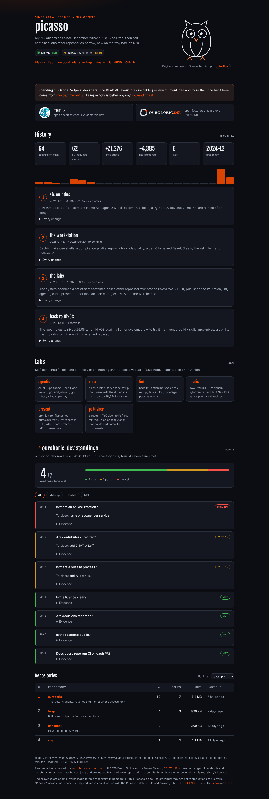

# site

picasso's page: the repository's history since 2024 (every commit on `main`, era by era), the
labs' cards, an original one-line drawing after Picasso picked at random on each visit, and the
live standings of the [ouroboric-dev](https://github.com/ouroboric-dev) organisation (its latest
readiness assessment and its public repositories, ranked).

Written in [Gleam](https://gleam.run) for the JavaScript target with [Lustre](https://lustre.build),
bundled by esbuild. The toolchain comes from this directory's `flake.nix`; the Hex packages are
pinned by checksum in `manifest.toml`. No token, no server.

```console
nix develop          # gleam, node, esbuild, just, python3
just build           # dist/: app.js, the prerendered index.html, static/ copied in
just test            # unit tests, on node
just ci              # format check, tests, build, check.py: what CI and the deploy run
just serve           # build, then http://localhost:8000
just history         # rewrite static/history.json (from a full clone)
```

| Path | Is |
|---|---|
| `src/picasso_site/app.gleam` | the model, the updates and the whole view |
| `src/picasso_site/family.gleam` | the Marola and Ouroboric logo band and its pinned URLs (hard rule) |
| `src/picasso_site/readiness.gleam`, `markdown.gleam` | the readiness assessment's parser and its inline markdown |
| `src/picasso_site/prerender.gleam` | writes `dist/index.html`, so the page reads without JavaScript |
| `src/picasso_site_ffi.mjs` | `fetch` with the localStorage cache, `URL`, `Intl` |
| `static/` | `style.css`, `drawings/`, `icons/` (the favicon), `plan/hosting-plan.pdf`, `history.json`: copied to `dist/` as is |
| `check.py` | the hard rules, checked on the built page |
| `releases.py` | the changelog from the tags and the Zenodo DOIs, written into `src/picasso_site_releases.mjs` (generated) before each build |

The version, the changelog and the DOIs are fixed at build time: `releases.py` reads the tags,
takes the concept DOI from `CITATION.cff` and asks Zenodo for each release's own DOI, and the
result is compiled into the bundle and the prerendered page. If Zenodo cannot be reached, the build
keeps the concept DOI. The standings come from the public GitHub API at view time, cached ten
minutes per browser because unauthenticated calls are limited to 60 an hour per IP.

Published at <https://h0ffmann.github.io/picasso/> by `.github/workflows/pages.yml` on every push
to `main` that touches `site/`. Where it is hosted and the move to a custom domain are planned in
[#85](https://github.com/h0ffmann/picasso/issues/85) and [`plan/hosting-plan.pdf`](static/plan/hosting-plan.pdf),
which the page links from its header.



In the screenshots the ouroboric-dev readiness items and repository numbers are mocked; everything else is real.
